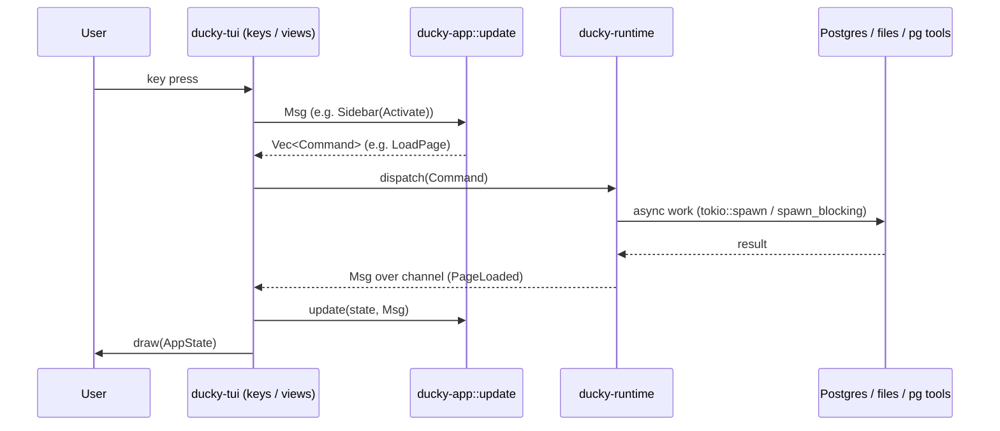

# Architecture

## Crates

```
crates/ducky-core      domain types, no dependencies
crates/ducky-config    TOML profiles, lookup, ${VAR} expansion     -> core
crates/ducky-sql       highlight, statement split, completion       -> core
crates/ducky-postgres  sessions, introspection, pages, scripts      -> core, sql
crates/ducky-files     SQL file store, dump store, pg_dump/pg_restore -> core
crates/ducky-app       pure state machine (AppState, Msg, Command, update) -> core, sql
crates/ducky-runtime   executes Command on tokio, answers with Msg  -> app, config, sql, postgres, files
apps/ducky-tui         binary `ducky`: keys, rendering, effects     -> app, runtime, config, sql
```

Dependencies only point downwards. Nothing below `apps/ducky-tui` knows about the terminal.

## Event loop

`ducky-app::update(&mut AppState, Msg) -> Vec<Command>` is pure. `ducky-runtime::Runtime::dispatch(Command)` spawns the IO on tokio and sends answers back as `Msg` over an unbounded channel. The TUI maps keys and mouse events to `Msg` and renders `AppState`.



Responses carry their request (`PageLoaded { request }`, `DetailsLoaded { relation }`, `FilePreviewLoaded { name }`, `ScriptFinished { tab_id, report }`); `update` drops responses that no longer match the state.

## Tabs and focus

`Workspace` holds `tabs: Vec<Tab>` and `active_tab_index`. A `Tab` has a `TabId` and a `TabContent`: `Table(TableView)` (one per relation from the sidebar or the palette, reused when reopened; foreign-key navigation adds one per relation and filter), `Query(QueryView)` (numbered `Query N` unless named after a file), or the singletons `Files`, `Dump`, `Restore`. Per-tab state (page, cursor, document, run state) lives in the tab; `TabsMsg` opens, switches and closes tabs. The sidebar lists only the relations of `schema_name`.

`Msg::OpenPalette` opens `Modal::Palette(CommandPalette)`; `Workspace::palette_items(query)` lists `PaletteItem`s whose `PaletteAction` switches to a tab, runs an action (new query, SQL files, dump, restore, schema, toggle sidebar, switch profile, refresh, reconnect, disconnect, help, quit) or opens a relation of any schema. An item may carry a `command_alias` (`Quit` has `:q`): a query starting with `:` lists only the items whose alias starts with it. `Msg::FocusPane(PaneDirection)` moves focus between sidebar, main pane, editor and results.

`Workspace::sidebar` holds the sidebar `width` (`DEFAULT_SIDEBAR_WIDTH` 32, `SidebarMsg::Widen` / `Narrow` / `SetWidth` within 20..=80) and `is_collapsed` (`SidebarMsg::ToggleCollapsed`). Focus changes go through `Workspace::set_focus`, which expands a collapsed sidebar when it receives the focus, so a collapsed sidebar is never focused. The TUI lays it out with `layout::sidebar_width` (0 when collapsed, otherwise capped so the main column keeps 40 columns).

## Switching profile

Profiles carry an optional `project` and `tags`; `Profile::target()` reads `host[:port]/database` from the url text. One picker model serves the start screen (`Screen::Profiles(ProfilePicker)`) and the in-workspace switch (`Modal::ProfilePicker(ProfilePicker)`, opened by `Msg::OpenProfilePicker` from the palette's `Switch profile…` or `Space p`): `profile_rows(profiles, filter)` yields `ProfileRow::Project` headers and `ProfileRow::Profile(index)` rows, and `ProfilesMsg` edits the filter, moves the selection over profile rows and toggles `PickerMode`. The TUI renders both through `views::profile_picker` and maps keys through `keys::profiles`.

Picking another profile in the modal keeps the workspace and its tabs and emits `Command::Connect` for the other profile, recording `Workspace::switching_profile_index`; it is refused while a script, a dump or a restore runs. `Msg::Connected { profile_index, .. }` in a workspace is a reconnect when `profile_index` is the workspace's, a switch when it matches `switching_profile_index` (success: profile, session and tools replaced, catalog and every table tab page reloaded, details reset; failure: error notice, the runtime keeps the old connection), and is ignored otherwise. `QueryView::ran_on_profile_label` records the profile a script was started on.

Only one script runs at a time: `running_script_tab_id` records the query tab that issued `Command::RunScript { tab_id, .. }`; `Run` from any tab is refused while it is set, and `ScriptFinished { tab_id, .. }` clears it and stores the report in that tab (if still open).

`QueryMsg::Run` (and `FileOpened { run_after_open: true }`) first applies the running / blank guards, then `ducky_sql::find_parameters`: without parameters it emits `RunScript`; otherwise it opens `Modal::Parameters(ParameterForm { tab_id, sql, fields, selected_field_index })`, one `ParameterField { name, input, is_raw }` per parameter prefilled from the tab's `QueryView::parameter_values`. `ModalMsg::Input` / `Next` / `Previous` / `ToggleRaw` edit the form; `Submit` merges the values into `parameter_values`, closes the form and runs `ducky_sql::bind_parameters(sql, values)` through the same guarded path, so reports hold the bound SQL.

Before `RunScript`, `update/run_confirmation.rs` applies the connected profile's kind: `local` runs at once, `prod` always opens `Modal::Confirm(ConfirmKind::RunScript { tab_id, sql })` with the bound SQL, and `staging` asks until the tab has `QueryView::confirmed_profile_index == Some(profile_index)`, which a confirmed submit sets and a profile switch clears on every tab (so switching away and back asks again). `Submit` re-checks the running guard; `Cancel` notices `Run cancelled`. SQL file execution (`FilesMsg::Execute`) has no confirmation of its own: it emits `OpenFile { run_after_open: true }` and the opened text goes through this same path. The TUI renders the popup in `views::confirm` with the profile accent, the first three SQL lines and the transaction mode.

`load_catalog` fills `Relation::foreign_keys` with `ForeignKeyLink { name, columns, referenced, referenced_columns }` (key order); `Catalog::referencing(relation)` derives the incoming links. `TableMsg::GoToReferenced` and `TableMsg::FindReferencing` (keys `gd` / `gr`) read the cursor row of the active data tab, build a filter with `ducky_sql::quote_identifier` / `quote_literal` (`"col" = 'value'` joined with ` AND `) and open a new `Table` tab on it, or activate a tab with the same relation and filter; several incoming links go through `Modal::ReferencePicker`. These tabs are plain filtered table tabs: the filter can be edited or cleared like any other.

`TableView` keeps a row selection for the current page (`marked_row_indexes`, `visual_anchor_row_index`, `selected_row_indexes()` = marks ∪ the anchor-to-cursor range). `TableMsg::ToggleRowMark` / `ToggleVisualSelection` / `ClearSelection` (keys `v` / `V` / `Esc`) edit it; `reload_page` and `PageLoaded` clear it, so pagination, sort, filter and reload drop it. `TableMsg::EditSelectedRows` (key `e`) builds an `UPDATE` preset in `update/selection.rs`: key columns are the catalog primary key, else `id`; values come from the page cells through `ducky_sql::quote_literal`, the cursor column gets a `:<column>` (or `:value`) parameter, and the text opens in a new `Query` tab, so running it goes through the usual parameters form.

Draft cell edits live in `TableView::cell_drafts` (`BTreeMap<GridCursor, Cell>`, row then column order) next to the page they modify, so the grid can show them over the original values and the original key values stay available for the `WHERE` clause. `update/cell_editor.rs` opens the editor (`TableMsg::ChangeCell`, key `c`) from the catalog column: enum labels become a `CellInput::Choice` list, `boolean` toggles without a modal, other types get a `CellInput::Text` input in `Modal::CellEditor`; it commits a value to every target row and drops drafts equal to the original cell. `update/cell_edits.rs` reverts, discards and saves: `SaveDrafts` (`Ctrl+s`) builds one `UPDATE` per drafted row with the key columns shared with the `e` preset in `update/row_keys.rs`, asks for confirmation on `staging` / `prod` and emits `Command::SaveCellEdits`. The runtime sends the whole text through `PgSession::apply_edits` on the browse connection: a multi-statement simple query is one implicit transaction, so one failing statement rolls back the others, and `Msg::CellEditsSaved` carries one updated-row count per statement. While a tab has drafts, everything that would reload its page (pagination, sort, filter, reload, close) is refused and `PageLoaded` skips it; `reload_page` clears drafts, so reconnecting or switching profile drops them.

Table pages use `AppState::page_size` (set with `AppState::with_page_size` from the config's `page_size`, default `DEFAULT_PAGE_SIZE`).

In `apps/ducky-tui`, `TuiState` keeps view-only state per tab in maps keyed by `TabId`: `editors` (one edtui `EditorPanel` per query tab), `table_viewports`, `table_cursor_cells` (on-screen area of the cursor cell, returned by `render_grid` and used to draw the cell editor over it), `results_viewports`, `structure_scrolls`.

## Mouse

`main.rs` enables mouse capture; `event_loop` passes `Event::Mouse` to `mouse::handle_mouse(&state, &mut tui, event) -> Vec<Msg>`. Hit testing uses `TuiState::mouse_targets: Vec<(Rect, MouseTarget)>`: `views::draw` clears it, and every view that draws something clickable pushes its areas in drawing order, so the handler takes the last target containing the point (the topmost one). `views::modal::render` inserts the modal's whole area before the targets its popup pushed, after the main UI's targets. The targets:

|Target|Pushed by|Click|Wheel|
|---|---|---|---|
|`SidebarList`|`views::sidebar` (whole sidebar)|focus the sidebar|3 × `SidebarMsg::Next` / `Previous`|
|`SidebarItem(index)`|`views::sidebar` (visible rows, scroll applied)|`SidebarMsg::Select(index)` then `Activate`|same as the list|
|`SidebarBorder`|`views::sidebar` (right border column)|start a drag: `Drag` sends `SetWidth(column - sidebar.x + 1)`, `Up` ends it|—|
|`Tab(index)`|`views::tabs` (visible labels)|`TabsMsg::Select(index)`|—|
|`Grid(pane)`, `GridHeader { pane, column_index }`, `GridCell { pane, row_index, column_index }`|`widgets::grid::render_grid` (`GridOptions::pane`), the whole results block|cell: `TableMsg::SelectCell` / `QueryMsg::SelectCell`, double click `ChangeCell` / `OpenRowDetail`; table data header: `SelectCell` on the cursor row then `CycleSort`; elsewhere: focus the pane|3 × `Move(Down / Up)`|
|`Editor(tab_id)`|`views::editor`|focus the editor, forward to edtui (cursor, drag selection)|edtui|
|`Scroll(ScrollArea)`|`views::structure`, `views::help`, `views::files` (preview), `views::job_log`|focus the main pane|3 lines of the same scroll state the keys change|
|`Modal`|`views::modal::render` (popup area)|nothing inside; a click outside any `Modal` area sends `ModalMsg::Cancel`|`ModalMsg::Next` / `Previous`|
|`ModalItem(index)`|palette, schema picker, reference picker, profile switch popup, enum choice list|`ModalMsg::Select(index)` then `Submit`|same as the modal|
|`ProfileRow(profile_index)`|start-screen profile picker|`ProfilesMsg::Select` then `Connect`|`ProfilesMsg::Next` / `Previous`|
|`FileItem(index)`|`views::files::render_entries` (SQL files, dumps)|`FilesMsg::Select` / `RestoreMsg::Select`; double click `Open` / `Start`|`Next` / `Previous`|

A double click is a second press on an equal target within 400 ms (`TuiState::last_click`). Any press dismisses the notice first; right and middle buttons are ignored.

## Adding a view

1. Add state to `ducky-app/src/state`, a `TabContent` variant (and a `PaletteAction` to open it), a `Msg` family and its `update/` module; add `Command`s if IO is needed, with tests in `crates/ducky-app/tests`.
2. Handle new commands in `ducky-runtime`, answering with `Msg`.
3. In `apps/ducky-tui`: `views/<name>.rs` (`render(frame, area, &ViewContext, &mut TuiState)`, pushing a `MouseTarget` for each clickable area), `keys/<name>.rs`, dispatch in `views/mod.rs` and `keys/mod.rs` (and the click / wheel mapping in `mouse/`), rows in `keys/help.rs` and `docs/keybindings.md`.

## Another front-end

A Dioxus (or any) UI reuses every crate except `apps/ducky-tui`: own an `AppState`, feed events through `update`, pass commands to `Runtime::dispatch` (inside a tokio runtime), and render from state. `ducky-sql::highlight` gives tokens for colouring independent of the widget toolkit.

## Connections and transactions

Each session opens two connections with `tokio-postgres` (simple-query protocol, every value as text):

- `browse`: catalog, relation details, table pages.
- `script`: user SQL. A long or open script never blocks browsing; `Ctrl+c` sends a cancel request for it.

Scripts are split into statements by `ducky-sql::split_statements` and executed one by one, keeping at most 10 000 rows per result.

- `Transaction` (default, ` one transaction `): `BEGIN`, statements, `COMMIT`; the first failure stops and issues `ROLLBACK`.
- `AutoCommit` (` autocommit `, toggled with `Ctrl+t`): statements are sent as-is and stop at the first failure; earlier statements stay committed.

After a script that affected rows, the catalog is reloaded. Table data changes either through the editor or through draft cell edits saved from the data tab.
