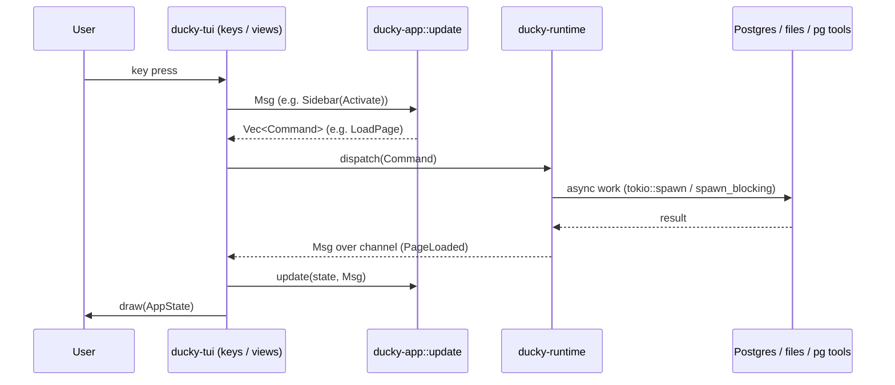

# Architecture

## Crates

```
crates/ducky-core      domain types, no dependencies
crates/ducky-config    TOML profiles, lookup, ${VAR} expansion     -> core
crates/ducky-sql       highlight, statement split, completion       -> core
crates/ducky-postgres  sessions, introspection, pages, scripts      -> core, sql
crates/ducky-files     SQL file store, dump store, pg_dump/pg_restore -> core
crates/ducky-app       pure state machine (AppState, Msg, Command, update) -> core
crates/ducky-runtime   executes Command on tokio, answers with Msg  -> app, config, sql, postgres, files
apps/ducky-tui         binary `ducky`: keys, rendering, effects     -> app, runtime, config, sql
```

Dependencies only point downwards. Nothing below `apps/ducky-tui` knows about the terminal.

## Event loop

`ducky-app::update(&mut AppState, Msg) -> Vec<Command>` is pure. `ducky-runtime::Runtime::dispatch(Command)` spawns the IO on tokio and sends answers back as `Msg` over an unbounded channel. The TUI maps keys to `Msg` and renders `AppState`.



Responses carry their request (`PageLoaded { request }`, `DetailsLoaded { relation }`, `FilePreviewLoaded { name }`); `update` drops responses that no longer match the visible state.

## Adding a view

1. Add state to `ducky-app/src/state`, a `MainView` variant, a `Msg` family and its `update/` module; add `Command`s if IO is needed, with tests in `crates/ducky-app/tests`.
2. Handle new commands in `ducky-runtime`, answering with `Msg`.
3. In `apps/ducky-tui`: `views/<name>.rs` (`render(frame, area, &ViewContext, &mut TuiState)`), `keys/<name>.rs`, dispatch in `views/mod.rs` and `keys/mod.rs`, rows in `keys/help.rs` and `docs/keybindings.md`.

## Another front-end

A Dioxus (or any) UI reuses every crate except `apps/ducky-tui`: own an `AppState`, feed events through `update`, pass commands to `Runtime::dispatch` (inside a tokio runtime), and render from state. `ducky-sql::highlight` gives tokens for colouring independent of the widget toolkit.

## Connections and transactions

Each session opens two connections with `tokio-postgres` (simple-query protocol, every value as text):

- `browse`: catalog, relation details, table pages.
- `script`: user SQL. A long or open script never blocks browsing; `Ctrl+c` sends a cancel request for it.

Scripts are split into statements by `ducky-sql::split_statements` and executed one by one, keeping at most 10 000 rows per result.

- `Transaction` (default, `tx ON`): `BEGIN`, statements, `COMMIT`; the first failure stops and issues `ROLLBACK`.
- `AutoCommit` (`tx OFF`, toggled with `Ctrl+t`): statements are sent as-is and stop at the first failure; earlier statements stay committed.

After a script that affected rows, the catalog is reloaded. Table data is read-only; writes go through the editor.
